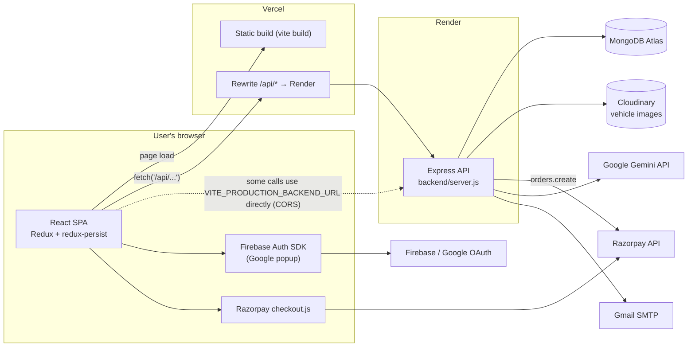
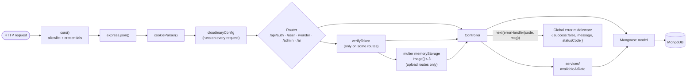
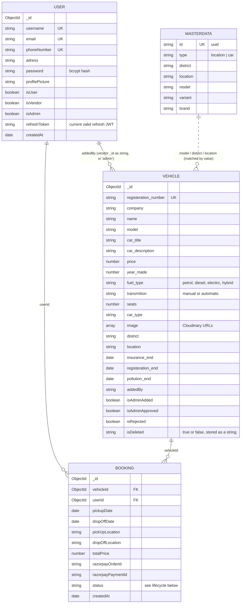
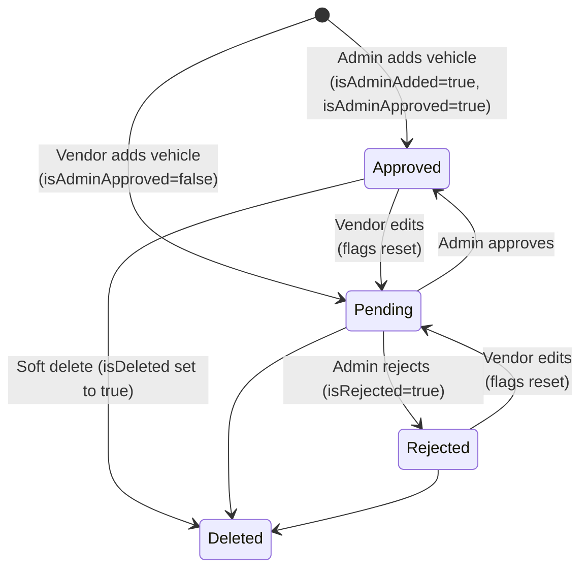
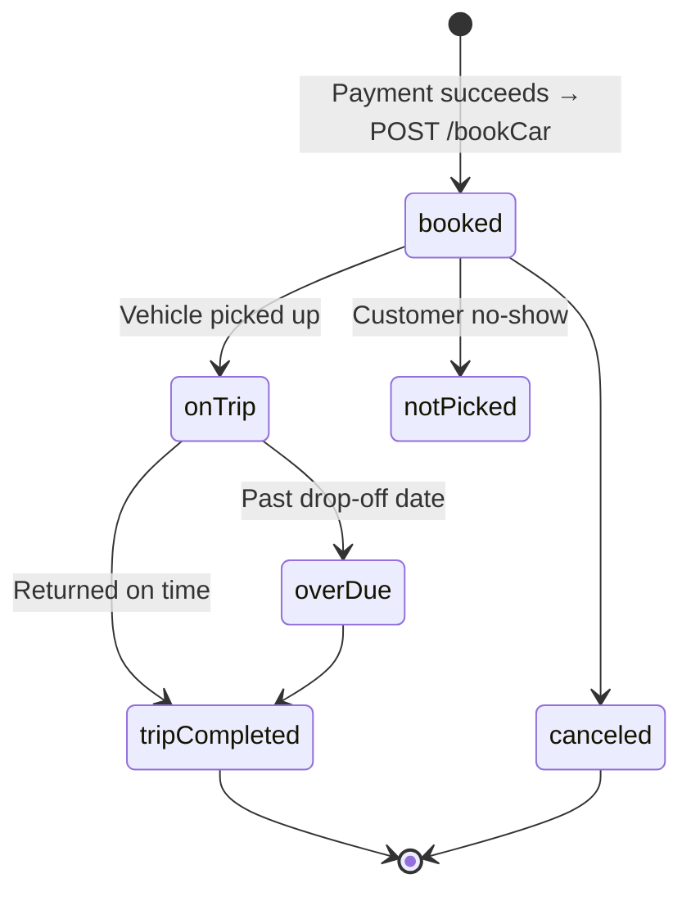
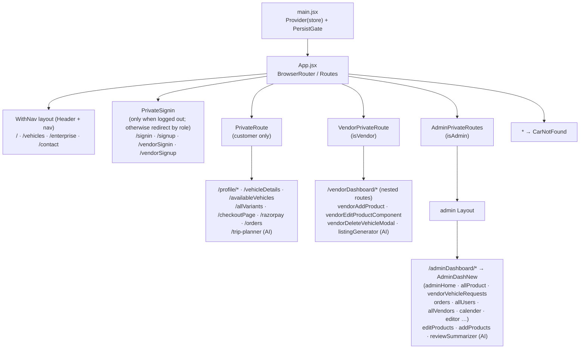
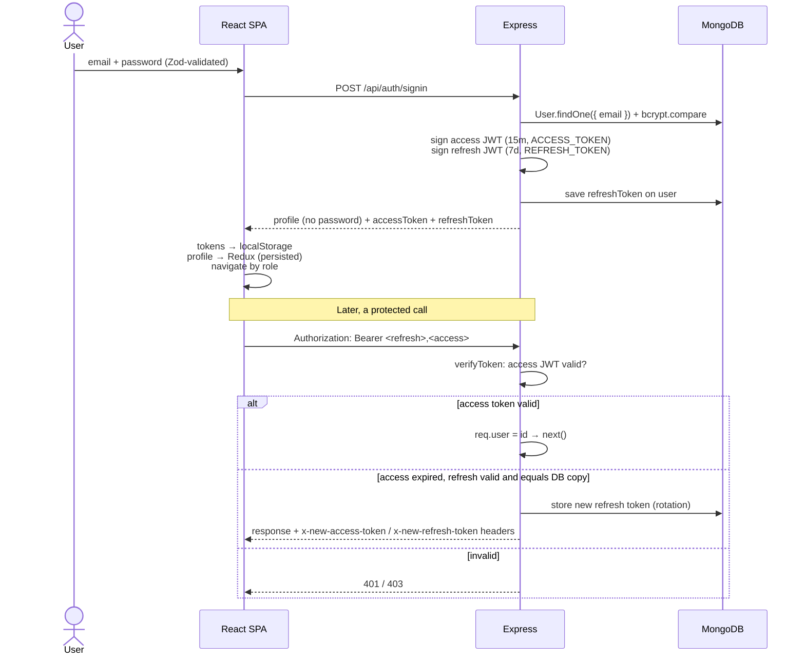
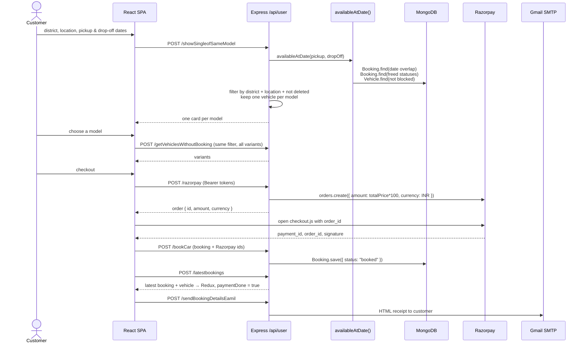
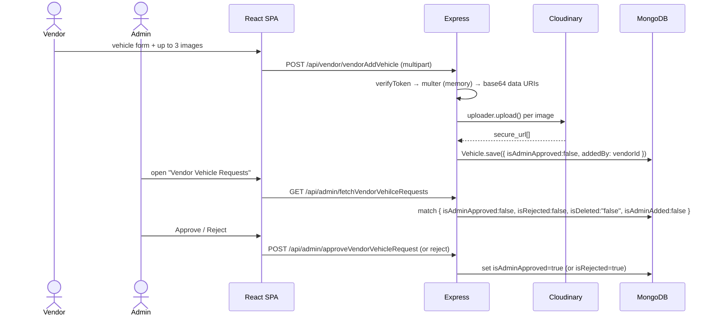
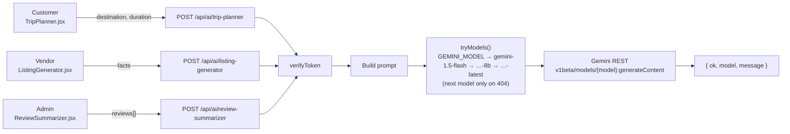

# Car Go — Architecture

This document describes how Car Go is put together: the deployed pieces, the backend layers, the frontend structure, the data model, and the main request flows. All diagrams are [Mermaid](https://mermaid.js.org/) and render directly on GitHub.

> Everything here was derived from the code in this repository. Where the code and the README disagree (for example AI provider and environment variable names), this document follows the code.

---

## 1. At a glance

| Concern | Technology | Where |
|---|---|---|
| Frontend | React 18 SPA, Vite, React Router v6 | `client/` |
| Client state | Redux Toolkit + `redux-persist` (localStorage) | `client/src/redux/` |
| UI kits | Tailwind CSS, MUI, Ant Design, Flowbite, Syncfusion, Nivo charts | `client/src/` |
| Forms / validation | React Hook Form + Zod | `client/src/pages/**` |
| Backend | Node.js + Express 4 (ES modules) | `backend/` |
| Database | MongoDB via Mongoose 8 | `backend/models/` |
| Auth | JWT access token (15 min) + refresh token (7 days), bcrypt; Google sign-in through Firebase Auth | `backend/utils/verifyUser.js`, `backend/controllers/authController.js`, `client/src/firebase.js` |
| Payments | Razorpay (server creates the order, browser runs `checkout.js`) | `userBookingController.js`, `client/src/pages/user/Razorpay.jsx` |
| Image storage | Multer (in-memory) → base64 → Cloudinary | `backend/utils/multer.js`, `backend/utils/cloudinaryConfig.js` |
| AI features | Google Gemini REST API (`generateContent`) with model fallback | `backend/controllers/aiController.js` |
| Email | Nodemailer over Gmail SMTP | `sendBookingDetailsEamil` in `userBookingController.js` |
| Hosting | Frontend on Vercel, API on Render, DB on MongoDB Atlas | `client/vercel.json`, `backend/server.js` |

---

## 2. System context



**How the browser reaches the API**

- **Production:** the SPA calls relative paths like `/api/user/bookCar`. `client/vercel.json` rewrites `/api/:path*` to the Render backend. To the browser it is a same-origin request, so CORS does not come into play.
- **Development:** `client/vite.config.js` proxies `/api` to `VITE_PRODUCTION_BACKEND_URL`.
- **Exceptions:** `SignIn.jsx` and `Vehicles.jsx` prefix calls with `VITE_PRODUCTION_BACKEND_URL`, which makes them cross-origin. That's why `server.js` has a CORS allowlist (`localhost:5173`, the Render frontend, the Vercel domain) with `credentials: true`.

---

## 3. Repository layout

```text
Car---Go/
├── package.json              # Backend deps + scripts (npm run dev → nodemon backend/server.js)
├── backend/
│   ├── server.js             # Express app: middleware, route mounting, error handler, Mongo connect
│   ├── routes/               # URL → middleware chain → controller
│   │   ├── authRoute.js      #   /api/auth
│   │   ├── userRoute.js      #   /api/user
│   │   ├── venderRoute.js    #   /api/vendor
│   │   ├── adminRoute.js     #   /api/admin
│   │   └── aiRoutes.js       #   /api/ai
│   ├── controllers/          # Request handlers, grouped by role
│   │   ├── authController.js
│   │   ├── aiController.js
│   │   ├── userControllers/  #   vehicles, bookings, payment, profile
│   │   ├── vendorControllers/#   vendor auth, vehicle CRUD, bookings
│   │   └── adminControllers/ #   vehicles, approvals, bookings, master data
│   ├── services/
│   │   └── checkAvailableVehicle.js   # date-overlap availability query
│   ├── models/               # Mongoose schemas: User, Vehicle, Booking, MasterData
│   └── utils/                # verifyToken, errorHandler, multer/base64, cloudinary config
└── client/
    ├── vite.config.js        # Dev proxy for /api
    ├── vercel.json           # Prod rewrite for /api
    └── src/
        ├── main.jsx          # Redux Provider + PersistGate → <App/>
        ├── App.jsx           # All routes and role guards
        ├── firebase.js       # Firebase app (Google sign-in)
        ├── redux/            # store.js + slices (user/, vendor/, adminSlices/)
        ├── components/       # Shared UI, route guards, layouts, OAuth buttons
        ├── hooks/            # useFetchLocationsLov (master data)
        └── pages/
            ├── user/         # Home, search, vehicle details, checkout, orders, profile, Trip Planner
            ├── vendor/       # Vendor auth, dashboard, vehicle CRUD, Listing Generator
            └── admin/        # Admin dashboard, vehicles, approvals, bookings, Review Summarizer
```

---

## 4. Backend

### 4.1 Request pipeline

Every request passes through the same global middleware in `server.js`. After that, the router decides whether authentication (`verifyToken`) or file parsing (`multer`) run before the controller.



**Layers**

| Layer | Responsibility | Notes |
|---|---|---|
| `routes/` | Map URL + verb to a middleware chain | Some chains include two handlers, e.g. `getVehiclesWithoutBooking → showAllVariants` (data is passed between them through `res.locals.actionResult`) |
| `controllers/` | Validate input, run queries, shape the response | Split by role: `userControllers`, `vendorControllers`, `adminControllers`, plus `authController` and `aiController` |
| `services/` | Logic shared across controllers | `availableAtDate(pickup, dropOff)` is the availability engine |
| `models/` | Mongoose schemas | No repository layer; controllers call models directly |
| `utils/` | Cross-cutting helpers | `verifyToken`, `errorHandler(status, message)`, multer + base64 conversion, Cloudinary `uploader` |

### 4.2 API surface

The "Auth" column shows whether `verifyToken` runs on that route.

**`/api/auth`** (`authRoute.js` → `authController.js`)

| Method & path | Auth | Purpose |
|---|---|---|
| `POST /signup` | – | Create customer (`isUser: true`), bcrypt password |
| `POST /signin` | – | Verify password, issue access + refresh JWTs, store refresh token on the user |
| `POST /google` | – | Find or create a customer from a Firebase Google profile; sets an `access_token` cookie |
| `POST /refreshToken` | header | Rotate tokens from `Authorization: Bearer <refresh>,<access>` |

**`/api/user`** (`userRoute.js`)

| Method & path | Auth | Purpose |
|---|---|---|
| `GET /listAllVehicles` | – | All vehicles |
| `POST /showVehicleDetails` | – | One vehicle by id |
| `POST /showSingleofSameModel` | – | Available vehicles for district/location/dates, **one per model** |
| `POST /getVehiclesWithoutBooking` | – | Available vehicles, **all variants of one model** |
| `POST /filterVehicles` | – | Aggregation filter by `car_type` / `transmition` |
| `POST /razorpay` | ✅ | Create a Razorpay order (amount × 100, INR) |
| `POST /bookCar` | – | Save a `Booking` with status `booked` |
| `POST /findBookingsOfUser` | – | User's bookings joined with vehicle (`$lookup`) |
| `POST /latestbookings` | – | Most recent booking + vehicle |
| `POST /sendBookingDetailsEamil` | – | Email booking receipt via Nodemailer |
| `POST /editUserProfile/:id` | – | Update username / email / phone / address |
| `POST /update/:id`, `DELETE /delete/:id` | – | Update / delete account (handlers read `req.user`) |
| `GET /signout` | – | Returns success; tokens are cleared client-side |

**`/api/vendor`** (`venderRoute.js`)

| Method & path | Auth | Purpose |
|---|---|---|
| `POST /vendorsignup`, `/vendorsignin`, `/vendorgoogle` | – | Vendor accounts (`isVendor: true`) |
| `GET /vendorsignout` | ✅ | Clear cookie |
| `POST /vendorAddVehicle` | ✅ + multer | Upload ≤ 3 images to Cloudinary, create vehicle with `isAdminApproved: false` |
| `POST /showVendorVehilces` | ✅ | Vehicles where `addedBy = vendor _id` and not deleted |
| `PUT /vendorEditVehicles/:id` | ✅ | Edit; resets `isAdminApproved` / `isRejected` so it goes back for review |
| `DELETE /vendorDeleteVehicles/:id` | ✅ | Soft delete (`isDeleted: "true"`) |
| `POST /vendorBookings` | ✅ | Bookings joined with vehicle details |

**`/api/admin`** (`adminRoute.js`)

| Method & path | Auth | Purpose |
|---|---|---|
| `POST /dashboard` | – | `signIn` then `adminAuth` |
| `POST /addProduct` | multer | Admin adds a vehicle (approved by default) |
| `GET /showVehicles` | – | All vehicles |
| `PUT /editVehicle/:id`, `DELETE /deleteVehicle/:id` | – | Edit / soft delete |
| `GET /fetchVendorVehilceRequests` | – | Vendor vehicles pending review |
| `POST /approveVendorVehicleRequest`, `/rejectVendorVehicleRequest` | – | Approval workflow |
| `GET /allBookings` | – | All bookings + vehicle details |
| `POST /changeStatus` | – | Set a booking's status |
| `GET /getVehicleModels` | – | Master data (car models + locations) for dropdowns |
| `GET /dummyData` | – | Seeds `MasterData` |
| `GET /signout`, `POST /profile` | – | Sign out / placeholder |

**`/api/ai`** (`aiRoutes.js` → `aiController.js`)

| Method & path | Auth | Used by | Prompt input |
|---|---|---|---|
| `POST /trip-planner` | ✅ | Customer — `TripPlanner.jsx` | `destination`, `duration` |
| `POST /listing-generator` | ✅ | Vendor — `ListingGenerator.jsx` | `facts` (string or object) |
| `POST /review-summarizer` | ✅ | Admin — `ReviewSummarizer.jsx` | `reviews[]` |

All three build a prompt and call `tryModels()`. It tries `GEMINI_MODEL` (if set), then a list of `gemini-1.5-flash*` models, moving on only when a model returns 404. The response is `{ ok, model, message }`.

---

## 5. Data model



**Key points**

- **One `User` collection, three roles.** Customers, vendors, and admins are all `User` documents, told apart by `isUser`, `isVendor`, and `isAdmin`. Route guards on the frontend and `adminAuth` on the backend read these flags.
- **`MasterData` is lookup data.** It holds the districts/locations a car can be picked up from and the car models/brands. The admin and vendor "add vehicle" forms read it from `/api/admin/getVehicleModels`. Vehicles copy these values as plain strings rather than holding a reference.
- **Deletes are soft.** Vehicles are never removed. `isDeleted` is set instead, and stored as the *string* `"true"`/`"false"`, so queries compare against strings.

### 5.1 Vehicle listing lifecycle (vendor → admin approval)



### 5.2 Booking status lifecycle

`Booking.status` is an enum. Admins and vendors change it by hand through `POST /api/admin/changeStatus`. The server does not enforce any order, so the diagram shows the intended flow only.



`availableAtDate()` treats bookings in `tripCompleted`, `canceled`, or `notBooked` as **not blocking**, so the vehicle shows up as available again for those dates.

---

## 6. Frontend

### 6.1 Composition and routing



- **Guards read Redux.** All three guards check `state.user.currentUser` and its role flags. Because `user` is persisted, a reload keeps the user signed in on the client.
- **The admin area is a nested app.** `AdminDashNew` has its own `<Routes>`, a sidebar (`SideBar`), and a `Navbar`. Its layout state (`activeMenu`, `screenSize`) lives in `adminDashboardSlice`.
- **No shared API client.** Components call `fetch('/api/...')` directly. Protected calls build `Authorization: Bearer ${refreshToken},${accessToken}` from `localStorage`.

### 6.2 Redux store (`client/src/redux/store.js`)

| Slice key | Holds | Persisted |
|---|---|---|
| `user` | `currentUser` (profile + role flags), loading/error flags, order modal | ✅ |
| `userListVehicles` | All vehicles, selected vehicle detail, variants | ✅ |
| `selectRideSlice` | Selected district, its locations, available cars | ✅ |
| `bookingDataSlice` | Search form: pickup/drop-off district, location, dates, selected vehicle | ✅ |
| `latestBookingsSlice` | Latest booking + `paymentDone` flag (triggers the receipt email) | ✅ |
| `vendorBookingSlice` | Vendor order-detail modal | ✅ |
| `sortfilterSlice` | Price sort, filter results, `variantMode` | – |
| `modelDataSlice` | Master data: models, companies, districts, locations | – |
| `vendorDashboardSlice` | Vendor vehicles, approval/edit/delete flags | – |
| `adminDashboardSlice` | Admin layout UI state | – |
| `statusSlice` | Admin add/edit vehicle status flags | – |
| `addVehicle` | Admin add-vehicle reducer | – |

---

## 7. Key flows

### 7.1 Email/password sign-in and token refresh



Google sign-in is different. `OAuth.jsx` (customers) and `VendorAuth.jsx` (vendors) open a Firebase popup and POST `{ name, email, photo }` to `/api/auth/google` or `/api/vendor/vendorgoogle`. The backend finds or creates the user, giving new users a random bcrypt password. It returns the profile and sets an `access_token` **cookie**; it does not return bearer tokens.

### 7.2 Search → checkout → payment → booking



### 7.3 Vendor adds a vehicle → admin approves



### 7.4 AI features



---

## 8. Configuration

### 8.1 Backend environment (`backend/.env`, loaded by `server.js`)

These are the names the code actually reads. Several differ from the README.

| Variable | Read in | Purpose |
|---|---|---|
| `PORT` | `server.js` | API port (default 3000) |
| `mongo_uri` | `server.js` | MongoDB connection string |
| `ACCESS_TOKEN` | auth controllers, `verifyUser.js` | Secret for access JWTs |
| `REFRESH_TOKEN` | auth controllers, `verifyUser.js` | Secret for refresh JWTs |
| `CLOUD_NAME`, `API_KEY`, `API_SECRET` | `utils/cloudinaryConfig.js` | Cloudinary credentials |
| `RAZORPAY_KEY_ID`, `RAZORPAY_SECRET` | `userBookingController.js` | Razorpay credentials |
| `GEMINI_API_KEY`, `GEMINI_MODEL` (optional) | `aiController.js` | Gemini access and preferred model |
| `EMAIL_HOST`, `EMAIL_PASSWORD` | `userBookingController.js` | Gmail account for receipts |

### 8.2 Frontend environment (`client/.env`)

| Variable | Read in | Purpose |
|---|---|---|
| `VITE_PRODUCTION_BACKEND_URL` | `vite.config.js`, `SignIn.jsx`, `Vehicles.jsx` | Dev proxy target and direct API base URL |
| `VITE_FIREBASE_API_KEY` | `firebase.js` | Firebase web API key |
| `RAZORPAY_KEY_ID` | `Razorpay.jsx` (`import.meta.env`) | Razorpay public key for checkout |

### 8.3 Running locally

```bash
npm install && npm run dev              # API → nodemon backend/server.js
cd client && npm install && npm run dev # SPA → Vite on :5173, /api proxied
```

---

## 9. Architectural notes and known gaps

These came up while mapping the code. They're listed so the design trade-offs are visible, not as a full review.

1. **Authorization is uneven.**
   - No `/api/admin/*` route uses `verifyToken`, and only `/dashboard` checks `isAdmin`. Approvals, booking status changes, and vehicle edits are therefore callable without a token.
   - Several `/api/user/*` routes take the user id from the request body or URL instead of the token (`findBookingsOfUser`, `latestbookings`, `editUserProfile/:id`).
   - A comment in `userRoute.js` says `verifyToken` was removed because of cross-site cookie problems on the free Vercel domain.
2. **Account update/delete expect a token that isn't checked.** `updateUser` and `deleteUser` read `req.user.id`, but their routes have no `verifyToken`, so `req.user` is undefined. Even with the middleware, `verifyToken` sets `req.user` to the id string itself, not to `{ id }`.
3. **Payments are not verified on the server.** `/bookCar` saves whatever Razorpay ids the browser sends. Razorpay's signature (`razorpay_signature`) is never checked with the key secret.
4. **Possible double-booking in availability.**
   - `availableAtDate()` returns a vehicle if it has *any* overlapping booking in a freed status (`canceled`, `tripCompleted`, `notBooked`), even when another overlapping booking is still `booked`.
   - Nothing re-checks availability at `/bookCar` time.
5. **Token rotation is one-sided.** `verifyToken` rotates the refresh token and returns the new pair in `x-new-*` response headers, but the client never reads them. After the first rotation the stored refresh token no longer matches the database copy.
6. **Vendor booking scope.** `vendorBookings` ignores the vendor's vehicles and returns every booking. The vendor UI also calls `/api/admin/allBookings` and `/api/admin/changeStatus` directly. In addition, `vendorBookingsController.js` uses `errorHandler` without importing it.
7. **`GET /api/admin/dummyData` disconnects the database.** `insertDummyData()` calls `mongoose.disconnect()` in its `finally` block and never sends a response. One call to this public route drops the running server's MongoDB connection.
8. **Config drift.**
   - The README lists OpenAI and different env names, but the code uses Gemini and the names in §8.
   - On the frontend, `RAZORPAY_KEY_ID` has no `VITE_` prefix, so Vite does not expose it by default.
   - `Razorpay.jsx` checks `data.ok` on the order response, but the backend returns the raw Razorpay order, which has no `ok` field.
9. **Smaller structural points.**
   - There is no shared API client, so auth headers are built in each component.
   - `cloudinaryConfig` runs on every request; it could run once at startup.
   - `isDeleted` is a string flag.
   - Several controllers call `next(error)` without `return` and keep executing.
